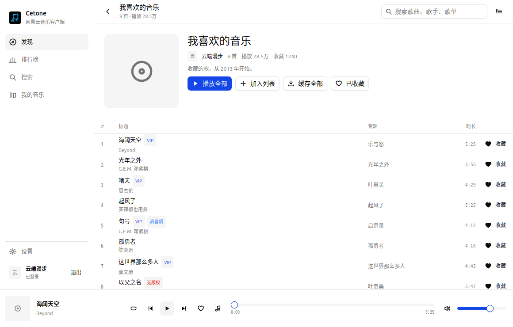
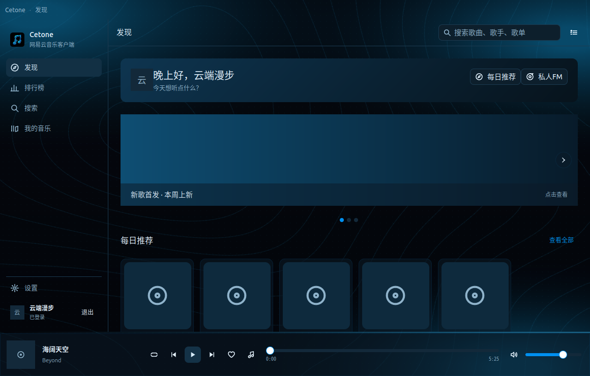
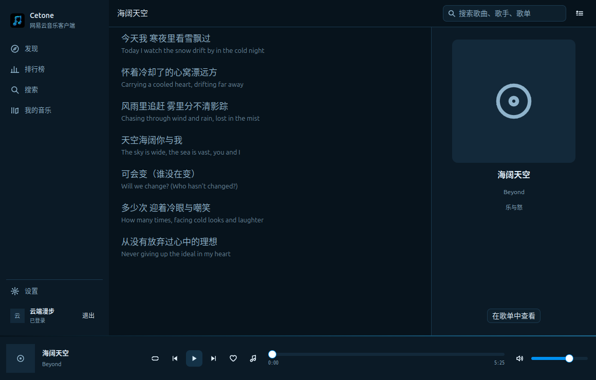
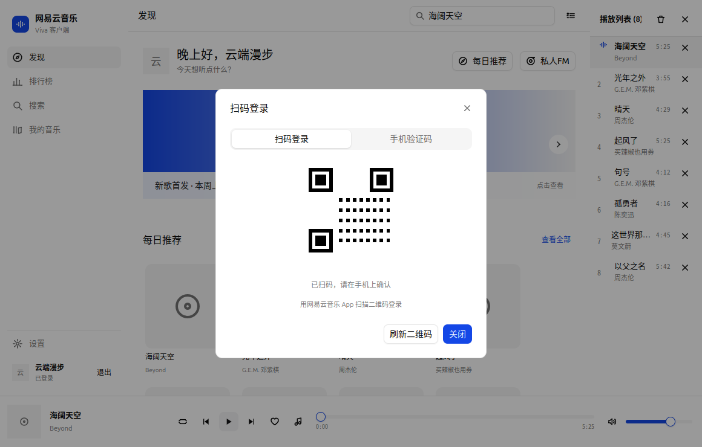
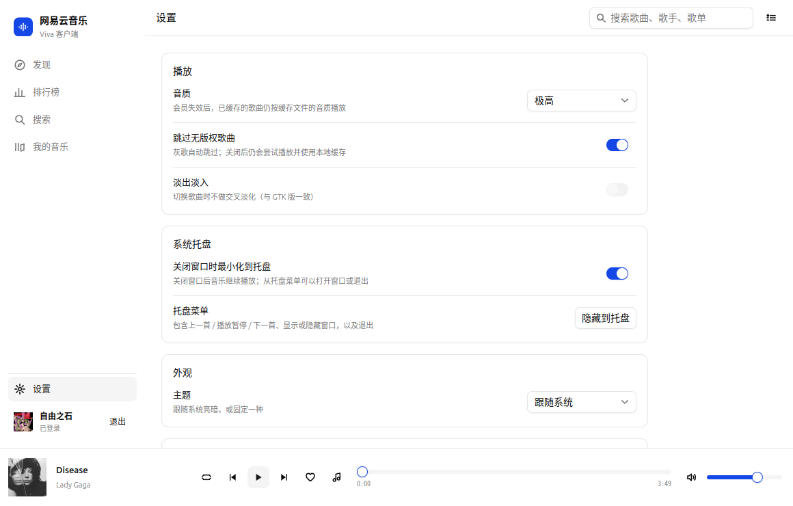

# Cetone

用 **Go + [Viva](https://vivaui.dev)** 重写的网易云音乐 Linux 桌面客户端，参照
[netease-cloud-music-gtk](https://github.com/gmg137/netease-cloud-music-gtk) 的功能范围。
没有 WebView，没有 GStreamer，没有 Rust/GTK 运行依赖：窗口由 Viva 直接画在 Vulkan 上，
音频由自带的解码器（mp3 / flac）解码后交给 ALSA。

## 为什么保留“缓存优先”播放

GTK 版最有价值的一点：**会员期内缓存下来的歌曲，在会员失效之后依然能播**。
这一版把它做成了播放路径的第一条规则，并且**沿用 GTK 版的缓存文件命名**
（`music_<歌曲ID>_<码率>`），所以旧的缓存目录可以直接用：

1. 播放一首歌时先查缓存：命中就直接播本地文件，**完全不请求播放地址**；
2. 未命中才向接口要 URL，边下边播；**下载一完成就落盘**，不等整首播完
   （中途退出也不会白下）；
3. 缓存目录里查不到当前音质时，会依次尝试其它音质（无损文件在任何档位都能播）；
4. 旧 GTK 客户端和用户自定义的缓存目录以**只读**方式参与查找，不会被改写；
5. **只缓存完整歌曲**：接口对无权限的歌曲返回试听片段（约 30 秒），这种片段
   不写缓存——否则离线曲库里存的就是残片，之后每次“离线播放”放的还是残片。
   中断/截断的下载同样不会被提升成缓存文件。

`internal/store/cache.go` 里的命名就是这个兼容契约，`cache_test.go` 里有一条测试
盯着它：名字一旦改掉，离线曲库就没了。

## 功能

| 页面 | 内容 |
| --- | --- |
| 发现 | 每日推荐、推荐歌单、新碟上架、登录引导 |
| 排行榜 | 官方榜单索引与榜单歌曲 |
| 搜索 | 单曲 / 歌手 / 专辑 / 歌单，输入即搜，历史记录 |
| 我的音乐 | 我喜欢的音乐、每日推荐、云盘、收藏歌单 |
| 歌单 / 专辑 / 歌手 | 详情页、播放全部、加入列表、收藏、缓存整张歌单 |
| 歌词 | 逐行高亮、翻译、跟随播放滚动、右侧封面信息 |
| 播放列表 | 侧栏快速版与整页版，可拖动排序、单曲移除 |
| 设置 | 音质、跳过灰歌、系统托盘、主题、缓存目录、代理、账号 |

播放：列表循环 / 单曲循环 / 不循环、心动模式（末尾自动追加推荐）、音量、静音、
进度拖动、桌面媒体控制（MPRIS，媒体键与声音菜单可用）、快捷键
（Ctrl+Space 播放/暂停、Ctrl+N 下一首、Ctrl+B 上一首、Ctrl+Q 播放列表、Ctrl+L 歌词、Ctrl+F 搜索）。

**系统托盘与后台运行**：托盘图标（StatusNotifierItem）显示当前歌曲，
菜单里有上一首 / 播放暂停 / 下一首、显示或隐藏窗口、退出。默认**关闭窗口不退出**，
只隐藏到托盘，音乐继续播放——静默播放正是音乐播放器最需要的场景。
桌面没有状态栏区域时（例如未装扩展的 GNOME），图标创建会失败，此时**不会**
把窗口藏起来：关闭窗口照常退出，否则用户就没有任何入口把窗口找回来了。
设置页的“系统托盘”分区会如实显示当前状态，开关也随之禁用。

登录：扫码登录（二维码由本程序绘制并轮询状态），会话以 Cookie 形式保存在配置目录。

## 截图

| | |
| --- | --- |
|  |  |
| 发现（真实接口数据，浅色） | 歌单详情 |
|  |  |
| 发现（深色） | 歌词 |
|  |  |
| 设置（深色） | 播放列表 |
|  |  |
| 扫码登录（真实二维码编码） | 设置里的系统托盘分区 |

截图由 `make shots` 无窗口渲染，因此不依赖显示器；其中的“发现（真实接口数据）”
一张来自 `internal/app` 的 live 测试，用的是真实 API 的返回。

## 图标

应用图标是画好的 1024×1024 原图（`artwork/icon-source.png`）。原图四角是白色
（整张是 RGB、没有透明通道），直接当图标会在窗口和托盘上露出一圈白边。所以
`make icons`（即 `tools/makeicon.py`）会：

1. 从画布边缘泛洪填充连通的白底，只去掉**外部**背景，图形内部的白色高光保留；
2. 边缘那圈抗锯齿像素按覆盖率反解出 alpha 并还原形状颜色，不是简单二值化，
   否则会留白边或锯齿；
3. 以**预乘 alpha** 缩放到 16/22/24/32/48/64/96/128/256/512/1024 各尺寸，
   避免缩小后在透明边缘出现暗边；
4. 输出 `data/icon.png`（打包用）、`internal/assets/icon.png`（内嵌，窗口与托盘用）
   以及 `icons/hicolor/*/apps/cetone.png`。

`make install-icons` 会把整套图标装到 `/usr/share/icons/hicolor` 并刷新缓存。

## 目录结构

```
main.go                    入口：窗口尺寸、XDG 目录
internal/ncm/              网易云 API：weapi/eapi 加密、Cookie 会话、各接口与解析
internal/player/           播放引擎：mp3/flac/wav 解码、边下边播、ALSA 输出、位置推算
internal/store/            设置、会话、队列、缓存、歌词、封面（纯 JSON + 文件）
internal/mpris/            Linux 桌面媒体控制（org.mpris.MediaPlayer2）
internal/app/              界面：窗口外壳、各页面、封面解码、二维码、后台任务队列
cmd/shots/                 无窗口渲染各页面的开发工具（-tags vivashots）
```

## 构建与运行

```sh
make build     # = go tool viva build，产出 build/cetone
make test      # = go test ./... -count=1（无窗口，驱动真实页面与输入）
make vet       # gofmt + go vet + go tool viva vet
make package   # = go tool viva package --target linux（tar.gz）
make run       # = go tool viva dev .（热重载）
```

需要 Go 1.26+；`viva` 命令由 `go.mod` 的 `tool` 行固定版本，用 `go tool viva` 调用，
不用单独安装。

**运行库**：程序本身只链接 libc，X11 / Vulkan / Pango / Cairo / 音频后端都是运行时
用 `dlopen` 打开的，所以**构建不需要任何 `-dev` 包**。运行时需要：

| 用途 | 库 |
| --- | --- |
| 窗口 | `libxcb.so.1`、`libvulkan.so.1` |
| 文字 | `libpango-1.0.so.0`、`libpangocairo`、`libpangoft2`、`libcairo.so.2`、`libfontconfig.so.1` |
| 声音 | `libasound.so.2`（桌面会路由到 PipeWire/PulseAudio） |

deb 包已把上面这些写进 `Depends`。没有声卡时程序照常运行：进度、歌词与 MPRIS 仍然
工作，只是静音。

## 支持的平台

| 平台 | 状态 | 怎么构建 |
| --- | --- | --- |
| Linux amd64 / arm64 | ✅ 已验证（本机实际播放、托盘、MPRIS） | 任意 Linux 主机直接构建 |
| Windows amd64 / arm64 | ✅ 可交叉编译（已验证 PE32+ 产物） | 从 Linux 交叉编译，无需 cgo |
| macOS arm64 / amd64 | ⚠️ **必须 macOS 主机** | Viva 的 Cocoa/Metal 桥是 cgo + Objective-C，无法交叉编译 |
| Web (wasm) | ❌ 不支持 | 浏览器目标没有托盘、文件系统/本地缓存与系统音频 |

发布用 GitHub Actions：`.github/workflows/release.yml` 推 tag 时在三个 runner 上
分别构建（`ubuntu-latest` 出 Linux/Windows，`macos-latest` 出 macOS），产物挂到
Release 并附 `SHA256SUMS`。`.github/workflows/ci.yml` 在每次提交上跑 vet、测试与
四平台交叉编译检查。

**签名**：默认不签名。Linux 包与 Windows zip 未签名（Windows 会提示 SmartScreen）；
macOS 未签名时需要右键“打开”。要签名就在仓库 Secrets 里配
`APPLE_SIGNING_IDENTITY`（配合 `APPLE_CERTIFICATE`/`APPLE_ID` 等），workflow 会自动改用
签名并额外产出 `.dmg`，无需改代码。

## 发布到此仓库

```sh
git tag v1.0.0
git push origin v1.0.0      # 触发 Release workflow，产物自动挂到 GitHub Release
```

也可以手动触发（Actions → Release → Run workflow），填版本号即可；workflow 会自己
打 tag。

## 数据位置

| 内容 | 路径 |
| --- | --- |
| 设置、会话、播放队列 | `~/.config/cetone/` |
| 音频缓存（新） | `~/.cache/cetone/music/` |
| 歌词、封面缓存 | `~/.cache/cetone/lyrics|/covers/` |
| 旧 GTK 版缓存（只读） | `~/.cache/netease-cloud-music-gtk4/` |

程序改名前用的目录（`~/.config/ncmviva` 等）会在首次启动时**自动迁移**到新名字下，
离线曲库、登录态和设置都不会丢；如果新旧目录同时存在，以新目录为准，旧目录原样保留。

## 已知限制

- **GPU 驱动**：窗口经 Vulkan 绘制。若驱动无法提供 Viva 需要的 surface
  （例如本机 NVIDIA 上偶发的 `VK_ERROR_EXTENSION_NOT_PRESENT`），程序会自动用
  `VIVA_SOFTWARE_RENDERING=1` 以 CPU 渲染重启一次，并在标准错误说明原因。
- **音频**：只解码 mp3 与 flac（接口正好用这两种格式覆盖全部音质档位）；
  不支持的容器会退回在线播放而不是崩溃。
- **未登录时的 VIP 歌曲**：只能播放约 30 秒试听片段，程序会提示“仅可试听”
  且不写入缓存。要完整离线播放，需要登录且当时的会员仍然有效。
- **桌面歌词**：未内置独立悬浮窗（GTK 版依赖外部 `desktop-lyrics`）。
- **托盘**：用 StatusNotifierItem（KDE / Cinnamon / XFCE 等）；GNOME 需要
  AppIndicator 扩展，否则没有托盘图标，关闭窗口即退出。

## 与 GTK 版的差异

- 渲染：GTK4 + libadwaita → Viva（自绘，Vulkan/XCB）。
- 播放：GStreamer → 自带 mp3/flac 解码 + ALSA；因此**只支持 mp3 与 flac**
  （接口对标准/较高/极高返回 mp3，对无损以上返回 flac，正好覆盖全部音质档位）。
- 桌面歌词依赖外部 `desktop-lyrics`，本版未内置；歌词页面为应用内全屏视图。
- 多语言：界面为中文，未接入 gettext。

## 许可

GPL-3.0-or-later，与上游一致（见 `COPYING`）。
