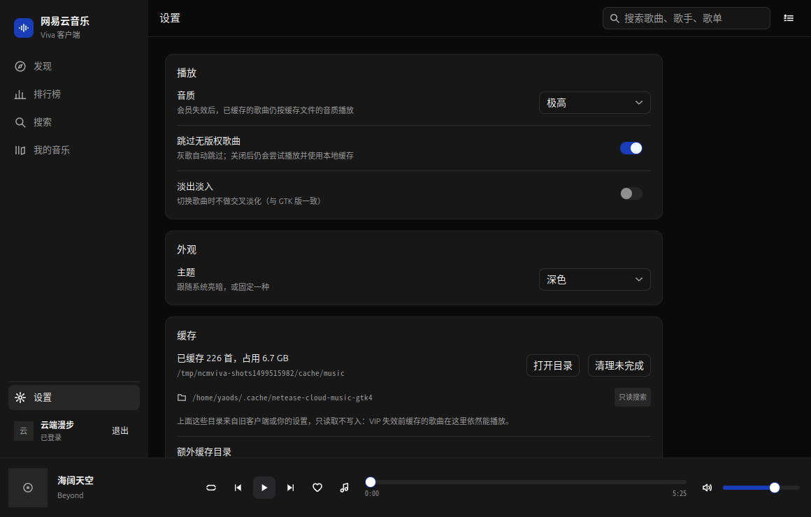
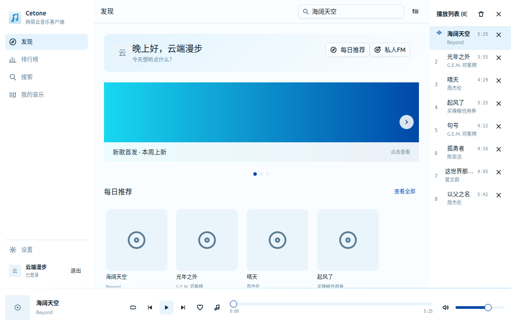

# ncmviva

用 **Go + [Viva](https://vivaui.dev)** 重写的网易云音乐 Linux 桌面客户端，参照
[netease-cloud-music-gtk](https://github.com/gmg137/netease-cloud-music-gtk) 的功能范围。
没有 WebView，没有 GStreamer，没有 Rust/GTK 运行依赖：窗口由 Viva 直接画在 Vulkan 上，
音频由自带的解码器（mp3 / flac）解码后交给 ALSA。

## 为什么保留“缓存优先”播放

GTK 版最有价值的一点：**会员期内缓存下来的歌曲，在会员失效之后依然能播**。
这一版把它做成了播放路径的第一条规则，并且**沿用 GTK 版的缓存文件命名**
（`music_<歌曲ID>_<码率>`），所以旧的缓存目录可以直接用：

1. 播放一首歌时先查缓存：命中就直接播本地文件，**完全不请求播放地址**；
2. 未命中才向接口要 URL，边下边播，播完写进缓存；
3. 缓存目录里查不到当前音质时，会依次尝试其它音质（无损文件在任何档位都能播）；
4. 旧 GTK 客户端和用户自定义的缓存目录以**只读**方式参与查找，不会被改写。

`internal/store/cache.go` 里的命名就是这个兼容契约，`cache_test.go` 里有一条测试
盯着它：名字一旦改掉，离线曲库就没了。

## 功能

| 页面 | 内容 |
| --- | --- |
| 发现 | 每日推荐、推荐歌单、新碟上架、登录引导 |
| 排行榜 | 官方榜单索引与榜单歌曲 |
| 搜索 | 单曲 / 歌手 / 专辑 / 歌单，输入即搜，历史记录 |
| 我的音乐 | 我喜欢的音乐、每日推荐、云盘、收藏歌单 |
| 歌单 / 专辑 / 歌手 | 详情页、播放全部、加入列表、收藏、缓存整张歌单 |
| 歌词 | 逐行高亮、翻译、跟随播放滚动、右侧封面信息 |
| 播放列表 | 侧栏快速版与整页版，可拖动排序、单曲移除 |
| 设置 | 音质、跳过灰歌、主题、缓存目录、代理、账号 |

播放：列表循环 / 单曲循环 / 不循环、心动模式（末尾自动追加推荐）、音量、静音、
进度拖动、桌面媒体控制（MPRIS，媒体键与声音菜单可用）、快捷键
（Ctrl+Space 播放/暂停、Ctrl+N 下一首、Ctrl+B 上一首、Ctrl+Q 播放列表、Ctrl+L 歌词、Ctrl+F 搜索）。

登录：扫码登录（二维码由本程序绘制并轮询状态），会话以 Cookie 形式保存在配置目录。

## 截图

| | |
| --- | --- |
|  |  |
| 发现（真实接口数据，浅色） | 歌单详情 |
|  |  |
| 发现（深色） | 歌词 |
|  |  |
| 设置（深色） | 播放列表 |
|  | |
| 扫码登录（真实二维码编码） | |

截图由 `make shots` 无窗口渲染，因此不依赖显示器；其中的“发现（真实接口数据）”
一张来自 `internal/app` 的 live 测试，用的是真实 API 的返回。

## 目录结构

```
main.go                    入口：窗口尺寸、XDG 目录
internal/ncm/              网易云 API：weapi/eapi 加密、Cookie 会话、各接口与解析
internal/player/           播放引擎：mp3/flac/wav 解码、边下边播、ALSA 输出、位置推算
internal/store/            设置、会话、队列、缓存、歌词、封面（纯 JSON + 文件）
internal/mpris/            Linux 桌面媒体控制（org.mpris.MediaPlayer2）
internal/app/              界面：窗口外壳、各页面、封面解码、二维码、后台任务队列
cmd/shots/                 无窗口渲染各页面的开发工具（-tags vivashots）
```

## 构建与运行

```sh
go build ./...          # 编译
go test ./... -count=1  # 无窗口的端到端测试（真实页面、绘制、输入路由）
viva vet                # 检查“能编译但画错”的页面写法
viva build              # 发布版程序 build/ncmviva
viva package --target linux   # 打包 tar.gz / deb
```

需要 Go 1.26+；运行时需要 `libasound.so.2`、X11 的 `libxcb` 与 Vulkan 加载器（都是系统库，不打包）。
没有声卡时程序照常运行：进度、歌词与 MPRIS 仍然工作，只是静音。

## 数据位置

| 内容 | 路径 |
| --- | --- |
| 设置、会话、播放队列 | `~/.config/ncmviva/` |
| 音频缓存（新） | `~/.cache/ncmviva/music/` |
| 歌词、封面缓存 | `~/.cache/ncmviva/lyrics|/covers/` |
| 旧 GTK 版缓存（只读） | `~/.cache/netease-cloud-music-gtk4/` |

## 已知限制

- **GPU 驱动**：窗口经 Vulkan 绘制。若驱动无法提供 Viva 需要的 surface
  （例如本机 NVIDIA 上偶发的 `VK_ERROR_EXTENSION_NOT_PRESENT`），程序会自动用
  `VIVA_SOFTWARE_RENDERING=1` 以 CPU 渲染重启一次，并在标准错误说明原因。
- **音频**：只解码 mp3 与 flac（接口正好用这两种格式覆盖全部音质档位）；
  不支持的容器会退回在线播放而不是崩溃。
- **桌面歌词**：未内置独立悬浮窗（GTK 版依赖外部 `desktop-lyrics`）。

## 与 GTK 版的差异

- 渲染：GTK4 + libadwaita → Viva（自绘，Vulkan/XCB）。
- 播放：GStreamer → 自带 mp3/flac 解码 + ALSA；因此**只支持 mp3 与 flac**
  （接口对标准/较高/极高返回 mp3，对无损以上返回 flac，正好覆盖全部音质档位）。
- 桌面歌词依赖外部 `desktop-lyrics`，本版未内置；歌词页面为应用内全屏视图。
- 多语言：界面为中文，未接入 gettext。

## 许可

GPL-3.0-or-later，与上游一致（见 `COPYING`）。
