# Windows 代码签名（SignPath）

Cetone 的 Windows 程序通过 [SignPath](https://signpath.io) 自动签名。开源项目可以向
[SignPath Foundation](https://signpath.org) 免费申请：证书由 SignPath Foundation 持有并以
它的名义签发（签名者显示为 *SignPath Foundation*），私钥保存在 SignPath 的 HSM 里，
**不会出现在本仓库或 CI runner 上**。

## 流程

```mermaid
flowchart LR
  tag["推送 tag v*"] --> build["release.yml windows job<br/>构建 amd64 + arm64 两个 exe"]
  build --> upload["上传 artifact<br/>windows-unsigned"]
  upload --> submit["signpath/github-action-submit-signing-request"]
  submit --> sp["SignPath 校验来源<br/>（仓库 / workflow / commit / GitHub 托管 runner）"]
  sp --> approve["审批人在 SignPath 批准"]
  approve --> sign["Authenticode 签名 + 时间戳"]
  sign --> download["action 下载已签名 exe"]
  download --> pkg["viva package --program<br/>打成 zip"]
  pkg --> release["publish：挂到 GitHub Release"]
```

两个架构的 exe 放在**同一个**签名请求里，所以每次发版只需要批准一次。
签名完成后 workflow 会用 `osslsigncode` 校验每个 exe 确实带签名，未签名就让发版失败，
而不是悄悄发出未签名的包。

没有配置 SignPath 时（`SIGNPATH_API_TOKEN` 或 `SIGNPATH_ORGANIZATION_ID` 缺失），
workflow 会跳过签名、照常发布未签名的 zip，并在运行页面给出警告。

## 一次性配置

1. **申请**：在 <https://signpath.org/apply> 提交开源项目申请（需要 OSI 许可证——本项目
   是 GPL-3.0、公开仓库、有发布记录、以及下方的代码签名策略）。
2. **在 SignPath 里建项目**（获批后 SignPath 会给出组织，通常也会协助建好）：
   - Project slug：`cetone`
   - 关联仓库：`https://github.com/tenyearnotdream/cetone`，Trusted Build System 选 **GitHub.com**
   - Artifact configuration：slug `initial`，内容粘贴
     [`.signpath/artifact-configuration.xml`](../.signpath/artifact-configuration.xml)
   - Signing policy：`release-signing`（Foundation 证书，需要人工审批）
3. **创建 CI 用户与 API Token**：SignPath → Users → 新建 CI user，赋予
   `release-signing` 策略的 *Submitter* 权限，生成 API token。
4. **在 GitHub 仓库里配置**（Settings → Secrets and variables → Actions）：

   | 类型 | 名字 | 值 |
   | --- | --- | --- |
   | Secret | `SIGNPATH_API_TOKEN` | 第 3 步的 API token |
   | Variable | `SIGNPATH_ORGANIZATION_ID` | SignPath 组织 ID（GUID） |
   | Variable（可选） | `SIGNPATH_PROJECT_SLUG` | 默认 `cetone` |
   | Variable（可选） | `SIGNPATH_SIGNING_POLICY_SLUG` | 默认 `release-signing` |
   | Variable（可选） | `SIGNPATH_ARTIFACT_CONFIGURATION_SLUG` | 默认 `initial` |

   测试阶段可以先用 SignPath 的 `test-signing` 策略（自签名证书、不需要审批）跑通流程，
   把 `SIGNPATH_SIGNING_POLICY_SLUG` 设成 `test-signing` 即可，跑通后删掉这个变量。
5. **发版**：照常推 tag（`git tag v1.0.3 && git push origin v1.0.3`），在 SignPath 里批准
   签名请求（链接会出现在 Actions 的 "Sign with SignPath" 步骤日志里），workflow 自动继续。

## 签名之后还会不会提示？

- **智能应用控制（Smart App Control）**：受信任 CA 签名的程序会被放行。
- **SmartScreen**：签名之后发布者显示为 SignPath Foundation；新证书仍需要积累下载声誉，
  前几个版本可能还会出现"不常下载"的提示，随下载量增长消失。

## 代码签名策略（Code signing policy）

SignPath Foundation 要求开源项目公开以下策略：

> Free code signing provided by [SignPath.io](https://about.signpath.io/), certificate by
> [SignPath Foundation](https://signpath.org/).

- **签名范围**：只签名本仓库源码、由 GitHub Actions 托管 runner 上
  [`release.yml`](../.github/workflows/release.yml) 构建出的 `cetone.exe`；不签名任何第三方程序。
- **角色**：
  - 提交者与审阅者（Committers and reviewers）：[仓库成员](https://github.com/tenyearnotdream/cetone/graphs/contributors)
  - 审批人（Approvers）：[@tenyearnotdream](https://github.com/tenyearnotdream)
- **审批**：每一次签名请求都由审批人在 SignPath 中人工批准，且只批准由 `v*` tag 触发的发版构建。
- **隐私**：本程序只连接网易云音乐接口与其 CDN（登录、搜索、播放、封面与歌词），以及用户自行
  配置的代理；不收集、不上传任何遥测或使用数据。详见 [README](../README.md)。
